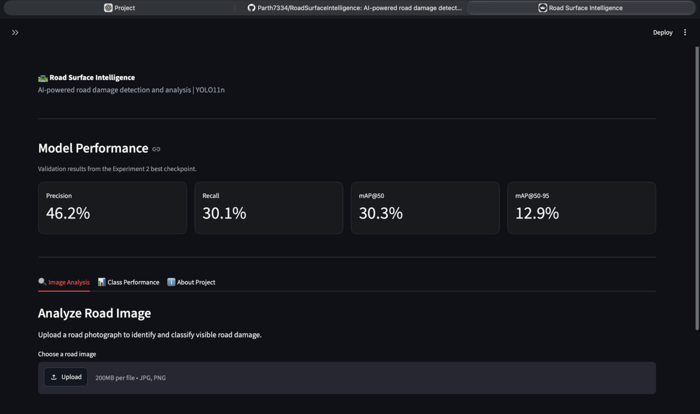
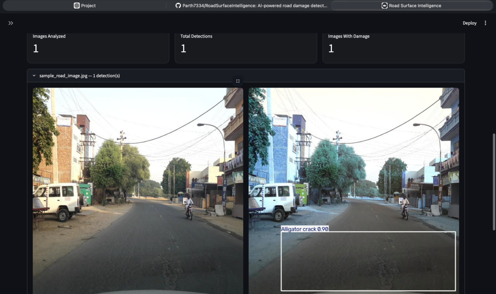
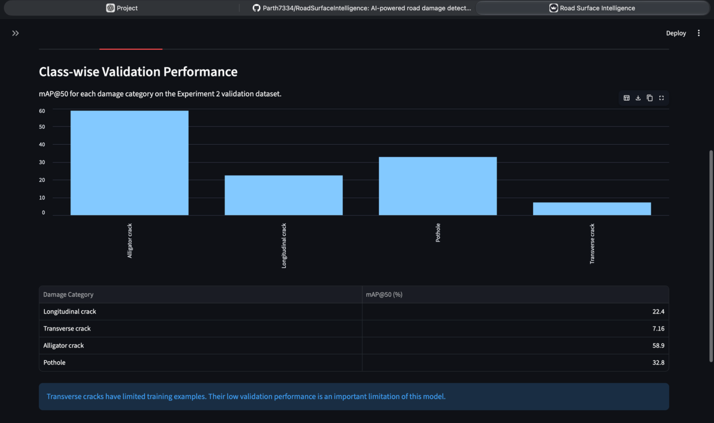
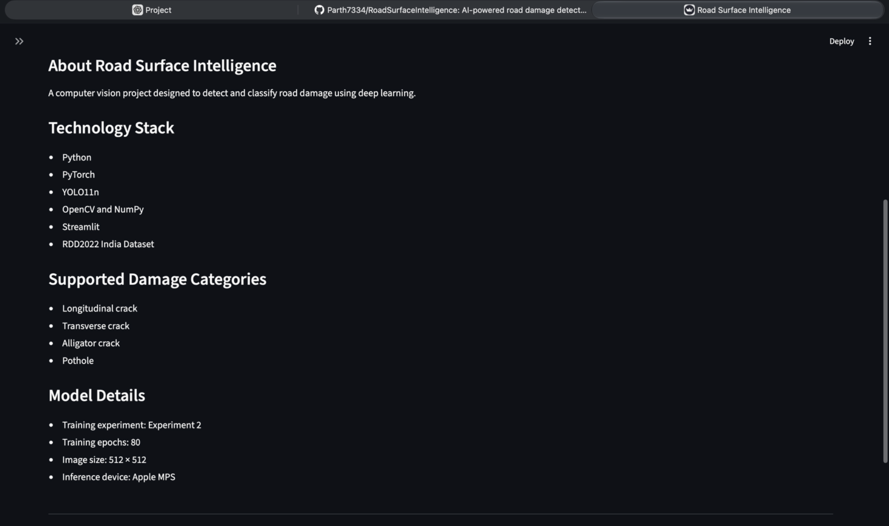

# Road Surface Intelligence

An AI-powered road damage detection and classification system built using YOLO11n, PyTorch and Streamlit.

The application analyzes road images, detects visible road damage, classifies damage categories, and displays bounding boxes with confidence scores.

## Supported Damage Categories

| Class ID | Category |
|---|---|
| D00 | Longitudinal crack |
| D10 | Transverse crack |
| D20 | Alligator crack |
| D40 | Pothole |

## Technology Stack

- Python
- PyTorch
- Ultralytics YOLO11n
- OpenCV
- NumPy and Pandas
- Streamlit
- Matplotlib
- RDD2022 India dataset

## Model Performance

The following results are from the best checkpoint of Experiment 2 on the validation dataset.

| Metric | Result |
|---|---:|
| Precision | 46.2% |
| Recall | 30.1% |
| mAP@50 | 30.3% |
| mAP@50-95 | 12.9% |

### Class-wise mAP@50

| Damage Category | mAP@50 |
|---|---:|
| Longitudinal crack | 22.4% |
| Transverse crack | 7.16% |
| Alligator crack | 58.9% |
| Pothole | 32.8% |

The model performs best on alligator cracks. Transverse crack detection remains a significant limitation because this category has very few training examples.

## Training Experiments

Three training configurations were evaluated:

1. Baseline: Original filtered dataset, 40 epochs.
2. Experiment 1: Reduced empty training images to 25%, 40 epochs.
3. Experiment 2: Added mixed-label images while retaining the reduced empty-image set, 80 epochs.

Experiment 2 achieved the best validation results.

Note: Experiment 2 changed both dataset composition and training duration, so the improvement cannot be attributed to either change independently.

## Dataset

This project uses the India subset of the Road Damage Detection 2022 (RDD2022) dataset.

The dataset was audited, annotations were validated, and the selected damage categories were converted into YOLO format.

The prepared dataset used:
- 5,320 training images in the baseline configuration.
- 1,330 validation images.
- Four target damage categories.

The dataset itself is not included in this repository.

## Project Structure

```text
RoadSurfaceIntelligence/
├── app.py
├── predict.py
├── requirements.txt
├── README.md
├── .gitignore
├── models/
│   └── road_damage_yolo11n.pt
├── scripts/
│   ├── audit_dataset.py
│   ├── validate_annotations.py
│   ├── prepare_yolo_dataset.py
│   ├── eda_yolo_dataset.py
│   ├── visualize_dataset.py
│   ├── create_experiment1.py
│   ├── create_experiment2.py
│   └── audit_target_classes.py
└── assets/
    ├── sample_road_image.jpg
    └── sample_prediction.jpg
## Application Screenshots

### Dashboard


### Road damage detection


### Class-wise validation performance


### About the project


## Technical Report

See [Road Surface Intelligence Technical Report](reports/Road_Surface_Intelligence_Technical_Report.pdf)
for dataset preparation, methodology, experiments, validation results, limitations and application screenshots.
